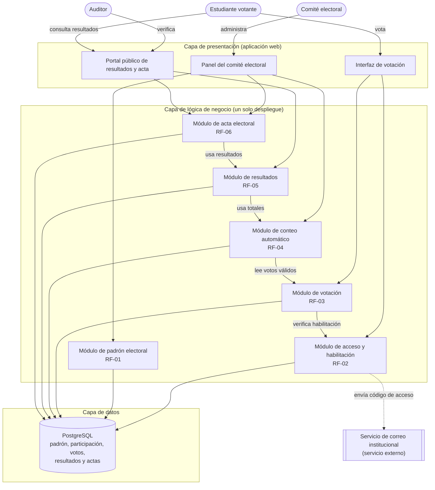
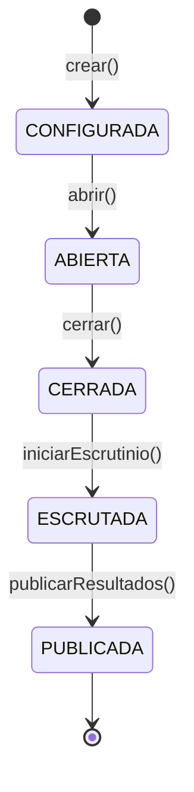
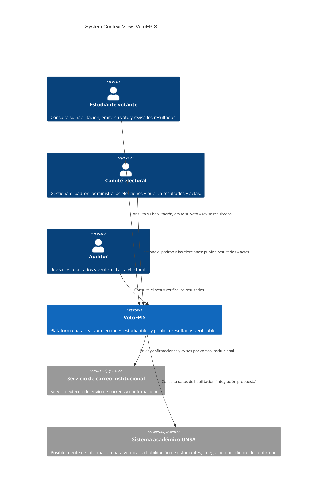

# VotoEPIS - Laboratorio 04: Fundamentos de arquitectura de software
Construcción de Software EPIS-UNSA

## Integrantes
2026-B Grupo B
| Nombre | Rol en el laboratorio |
|---|---|
| Morocco Saico Jose Manuel | Analista de Drivers (E1) y Matriz (E2) |
| Luque Guevara Fernando Gerson | Redactor de ADRs (E4) y Diagramador Mermaid (E3) |
| Hilacondo Begazo Emanuel David | Diagramador PlantUML/Python (E5, E6) |

## Caso
VotoEPIS es un sistema para la elección digital de delegados estudiantiles de la EPIS. Permite gestionar el padrón, emitir votos y publicar resultados auditables. El atributo de calidad crítico es la **Seguridad e integridad (QA-01)**, el cual asegura que el sistema protege el voto, evita alteraciones y rechaza intentos duplicados.

## Arquitectura elegida

## Decisiones arquitectónicas
* [ADR-001: Estilo arquitectónico](docs/architecture/adr/001-estilo-arquitectonico.md)
* [ADR-002: Base de datos](docs/architecture/adr/002-base-de-datos.md)
* [ADR-003: Auditoría y seguridad](docs/architecture/adr/003-auditoria-seguridad.md)

## Reflexión sobre el uso de la IA
El uso de herramientas de IA demostró ser un recurso sumamente valioso para la fase de exploración.
Sin embargo, su uso exige un alto nivel de pensamiento crítico por parte del equipo para evitar sesgos.
La IA tiende a sugerir patrones de diseño avanzados que pueden introducir sobreingeniería en el MVP.
Si estas sugerencias se aceptan sin verificación, ponen en riesgo las restricciones reales del proyecto.
Por ello, la decisión final siempre debe recaer en el juicio humano apoyado en la matriz de decisión.

## Diseño UML (Lab 05)

### Diagrama de Máquina de Estados (Elección)

### Enlaces a diagramas y documentación
*   [Diagrama de Clases (PlantUML)](docs/design/clases.puml)
*   [Diagrama de Secuencia - Emitir Voto (PlantUML)](docs/design/secuencia-emitir-voto.puml)
*   [Diagrama de Actividades - Escrutinio (PlantUML)](docs/design/actividades-escrutinio.puml)
*   [Diagrama de Paquetes (PlantUML)](docs/design/paquetes.puml)
*   [Ingeniería Round-Trip: Diagrama vs. Código](docs/design/round-trip.md)
*   [Auditoría de Consistencia (Reglas C1-C5)](docs/design/consistencia.md)
*   [Bitácora de IA (Lab 05)](docs/design/bitacora-ia.md)

## Arquitectura C4 (Lab 06)

### Diagrama de Contexto (Mermaid C4)

### Vistas Exportadas y Documentación C4
* [Inventario de Elementos C4](docs/architecture/c4/inventario.md)
* [Modelo Único en Structurizr DSL](docs/architecture/c4/workspace.dsl)
* **Imágenes de las 5 vistas C4:**
  * [Nivel 1: Diagrama de Contexto (PNG)](docs/architecture/c4/img/structurizr-Contexto.png)
  * [Nivel 2: Diagrama de Contenedores (PNG)](docs/architecture/c4/img/structurizr-Contenedores.png)
  * [Nivel 3: Diagrama de Componentes (PNG)](docs/architecture/c4/img/structurizr-Componentes.png)
  * [Vista Dinámica: Emitir Voto (PNG)](docs/architecture/c4/img/structurizr-EmitirVoto.png)
  * [Vista de Despliegue: Producción (PNG)](docs/architecture/c4/img/structurizr-Despliegue.png)
  * [Diagrama de Contexto Manual C4-PlantUML (PNG)](docs/architecture/c4/img/contexto-manual.png)
* [Comparación de Vistas y Herramientas (E4 y E6)](docs/architecture/c4/comparacion.md)
* [Revisión Oficial C4 y Auditoría IA (E7)](docs/architecture/c4/revision-c4.md)
* [Explicación para Público No Técnico (E7)](docs/architecture/c4/explicacion.md)
* [Bitácora de Uso de IA (Lab 06)](docs/architecture/c4/bitacora-ia.md)

## Patrones de diseño (Lab 07)

En el Laboratorio 07 se refactorizó el módulo `src/votacion` a partir de la versión inicial (`src/votacion/antes/servicio.py`), protegiendo el comportamiento observable mediante 14 pruebas de caracterización parametrizadas y aislando el asistente de consultas del reglamento electoral basado en IA.

### 1. Tabla de Trazabilidad: Olor → Patrón GoF → Principio SOLID → Prueba

| Olor de código detectado | Patrón GoF aplicado | Módulo / Clases | Principio SOLID | Prueba automatizada que lo verifica |
|---|---|---|---|---|
| Condicionales `if/elif` por fuente de habilitación (`LOCAL`, `ACADEMICO`) | **Strategy + Factory (registro)** | `elegibilidad.py` (`PadronPort`, `FabricaFuentes`) | OCP, DIP | `tests/test_patrones.py::test_open_closed_nueva_fuente_sin_modificar_servicio` |
| Acoplamiento a firmas y respuestas dispares de servicios externos | **Adapter** | `elegibilidad.py` (`PadronLocalAdapter`, `SistemaAcademicoAdapter`) | DIP, ISP | `tests/test_comportamiento.py::test_fuente_academica_simulada_habilita` |
| Bucles `for intento in range(3)` duplicados para manejar `TimeoutError` | **Decorator** | `decoradores.py` (`ConReintentos`) | SRP, OCP | `tests/test_patrones.py::test_e4_decorator_reintenta_solo_timeouts` y `test_e4_decorator_no_reintenta_rechazo` |
| Validaciones manuales de estado de la elección y riesgo de transiciones inválidas | **State** | `estados.py` (`EstadoBase`, `Configurada`, `Abierta`, `Cerrada`, `Escrutada`, `Publicada`) | SRP, OCP, LSP | `tests/test_patrones.py::test_state_transiciones_validas` y `test_state_impide_transicion_invalida` |
| Notificación por correo y auditoría de intentos duplicados acopladas al servicio | **Observer** | `eventos.py` (`PublicadorEventos`, `ConfirmacionCorreo`, `AuditoriaSeguridad`) | SRP, OCP | `tests/test_patrones.py::test_e4_observer_permite_suscriptores_sin_modificar_publicador` |
| Acoplamiento al proveedor LLM, llamadas repetidas y riesgo de respuestas sesgadas o inventadas | **Strategy + Adapter + Decorator + Chain of Responsibility** | `ia.py` (`ProveedorLLM`, `AdaptadorLLMSimulado`, `ConCache`, `SinIndicacionesDeVoto`, `SinResultadosInventados`) | SRP, OCP, DIP | `tests/test_patrones.py::test_e5_respuesta_valida_y_cache` y `test_e5_guardrails_bloquean_salida_invalida` |

### 2. Resumen de Métricas (`radon` Antes vs. Después)

| Métrica | Antes (`antes/servicio.py`) | Corte E2 (`servicio.py` + `elegibilidad.py`) | Después Completo (E2–E5) |
|---|---|---|---|
| **Complejidad de `emitir_voto()`** | 18 (C) | 13 (C) | **4 (A)** |
| **Complejidad ciclomática promedio** | 10.00 (B) | 2.92 (A) | **1.68 (A)** |
| **Líneas de código (SLOC)** | 73 SLOC | 113 SLOC | **259 SLOC** |
| **Archivos de producción** | 1 | 2 | **6** |
| **Pruebas en verde (`pytest`)** | 14 passed | 29 passed | **36 passed** |

### 3. Documentación y Artefactos del Laboratorio 07
* [Análisis de Olores de Código (E1)](docs/design/patrones/olores.md)
* [Métricas Radon y Análisis de Trade-off (E6)](docs/design/patrones/metricas.md)
* [Bitácora de Uso de IA (E7)](docs/design/patrones/bitacora-ia.md)
* [ADR-005: Patrones de Diseño en VotoEPIS (E8)](docs/architecture/adr/005-patrones-de-diseno.md)
* **Diagramas de Clases de los Patrones Aplicados (E7):**
  * [Habilitación: Strategy + Adapter + Decorator + Factory](docs/design/patrones/elegibilidad.puml)
  * [Ciclo de Vida: State](docs/design/patrones/estados.puml)
  * [Eventos y Auditoría: Observer](docs/design/patrones/eventos.puml)
  * [Asistente de IA Aislado: Strategy + Decorator + Chain of Responsibility](docs/design/patrones/ia.puml)
  * [Diagrama de Clases General Actualizado](docs/design/clases.puml)