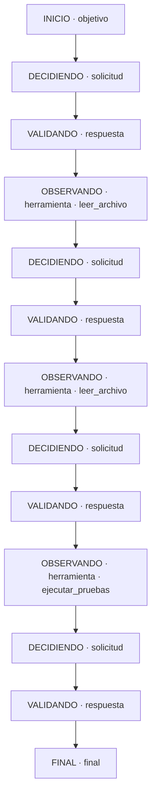

# Observación y métricas de trazas (E7)

La tabla compara una sesión de agente único por issue. Las métricas se calcularon desde los eventos JSONL, no desde el diff: **pasos** es el máximo `paso` (incluye la decisión final), **herramientas** cuenta eventos `herramienta`, **rechazos** cuenta eventos `rechazo`, **bloqueos** cuenta eventos `herramienta` con estado `BLOQUEADO`, y **contexto final** es `caracteres` de la última solicitud `solicitud`.

| Issue y evidencia | Pasos | Rondas | Herramientas usadas (acciones) | Rechazos por contrato | Acciones bloqueadas | Contexto final |
|---|---:|---|---|---:|---:|---:|
| ISSUE-01 — [sesión diagnóstica](trazas/issue-01-sesion-01/traza.jsonl) | 4 | No aplica: agente único | `leer_archivo` ×2; `ejecutar_pruebas` ×1 (3) | 0 | 0 | 6543 caracteres |
| ISSUE-02 — [variante A](trazas/issue-02-variante-a/traza.jsonl) | 6 | No aplica: agente único | `leer_archivo` ×2; `editar_archivo` ×1; `ejecutar_pruebas` ×1; `ver_cambios` ×1 (5) | 0 | 0 | 6796 caracteres |
| ISSUE-03 — [sesión 01](trazas/issue-03-sesion-01/traza.jsonl) | 9 | No aplica: agente único | `leer_archivo` ×2; `editar_archivo` ×1; `ejecutar_pruebas` ×1; `mapa_repo` ×1; `anotar` ×1; `leer_notas` ×1; `ver_cambios` ×1 (8) | 0 | 0 | 8199 caracteres |

## Cómo leer los datos

- Las tres filas son sesiones de agente único; por eso sus trazas no registran rondas de coordinación. No se confunde “sin rondas” con una ronda de revisor.
- La variante B de ISSUE-02 es una ejecución distinta: `trazas/issue-02-variante-b/resumen.json` informa **1 ronda**. No se mezcla con el contexto final de la variante A, porque esa variante no tiene una traza JSONL comparable.
- La sesión de ISSUE-01 se generó para completar la evidencia faltante mediante la CLI `ModeloInteractivo`, con decisiones de diagnóstico proporcionadas por el operador. No se presenta como una respuesta generada por un LLM: el código actual ya usa `casefold`, la prueba corrió con código 0 y no se aplicó edición. La sesión queda en `trazas/issue-01-sesion-01/` para poder auditar cada decisión y evento.
- Hay una discrepancia de línea base para ISSUE-01: `issues/ISSUE-01.md` describe un defecto pendiente y un xfail, pero el código actual normaliza con `casefold` y la ejecución registrada de `python -m pytest --runxfail -q tests/test_issue_01.py` terminó con `1 passed`. No se retiró ni modificó ningún marcador de prueba.

## Trayectoria observada: ISSUE-01

El diagrama se generó desde `trazas/issue-01-sesion-01/traza.jsonl` con `agentes/agente/traza.py`; muestra las dos lecturas, la prueba y la respuesta final, sin edición.

