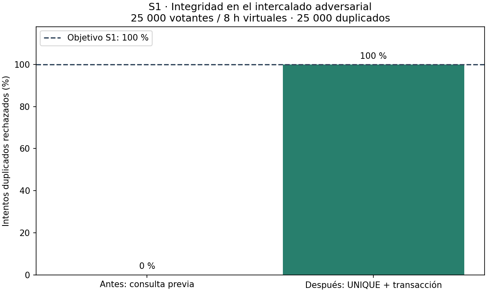

# Laboratorio 08 — E2: primera iteración ADD 3.0

Fecha: 31/10/2026. Estado: decisión de diseño evaluada en prototipo local.
Alcance exclusivo: E1–E2. No se implementan posteriores iteraciones, ATAM-lite
ni ejercicios E3–E8. Los scripts de `fitness/` son evidencia exigida por E2.

## Paso 1. Revisar las entradas

Entradas: [árbol y ocho escenarios](../utilidad/escenarios.md),
[drivers](../drivers.md), [ADR-001](../adr/001-estilo-arquitectonico.md),
[ADR-002](../adr/002-base-de-datos.md), [ADR-003](../adr/003-auditoria-seguridad.md),
[ADR-005](../adr/005-patrones-de-diseno.md), C4 y código/pruebas Lab 07.
El escenario de crecimiento del enunciado es 25 000 votantes durante ocho horas
con auditoría externa. No hay tasas de duplicados ni mediciones de producción.
Se mantienen R-01 a R-04 (mes, tres integrantes, tecnología conocida, presupuesto
bajo), monolito en capas, VPS único y PostgreSQL. El resumen de E1 distingue el
diseño documentado de las capacidades implementadas en los dobles de prueba.

## Paso 2. Establecer el objetivo de la iteración

Escenario objetivo: **S1 Seguridad/integridad (H,H)**. Cliente habilitado envía
dos emisiones solapadas, con elección abierta; el registro de participación y
voto acepta una y rechaza la adicional. Medida exacta de E1:

**Porcentaje de intentos duplicados rechazados =
100 × duplicados rechazados / intentos duplicados; objetivo 100 %.**

La prueba usa 25 000 intentos duplicados. Se cuenta como duplicado el segundo
intento de cada votante; la primera emisión debe ser aceptada. Se comprueban
además conteos para impedir un falso cumplimiento por rechazo de todo el tráfico.
S1 empata con S2 y S3 en (H,H); se selecciona por QA-01 crítico y RF-03:
aceptar votos adicionales compromete la legitimidad de todo resultado, incluso
si el servicio permanece disponible. Es una decisión abordable localmente antes
de evaluar continuidad operativa o desempeño en infraestructura real.

## Paso 3. Elegir el elemento que se refinará

Se refina la responsabilidad de persistencia del componente **Votación** del C4,
en el límite entre lógica y datos: la operación `registrar_emision` utilizada
por `ServicioVotacion._registrar_o_auditar`.
`AlmacenElectoralSimulado` comprueba un conjunto, añade participación y añade voto
con reversión ante excepción, pero no implementa una restricción de BD real.
El refinamiento mantiene el servicio, Strategy, State y Observer de ADR-005.
El prototipo vive aislado en `fitness/`; no reemplaza el almacén del Lab 07.

## Paso 4. Elegir conceptos de diseño

Los costos siguientes son comparaciones cualitativas de diseño, no cotizaciones,
plazos medidos ni cambios autorizados de infraestructura.

| Concepto / táctica | Ventaja | Desventaja / trade-off | Costo y complejidad estimados | Decisión |
|---|---|---|---|---|
| A. Exclusión mutua con bloqueo en memoria alrededor de consulta y escritura | Cambio acotado y evita el intercalado dentro de un proceso | Solo protege quienes comparten ese bloqueo; no garantiza unicidad frente a otro escritor; estado en memoria no es persistencia | Bajo en un proceso; administrar bloqueos por clave y todos los escritores eleva mantenimiento | No seleccionada como garantía principal; no materializa la restricción exigida por ADR-002 |
| B. Restricción UNIQUE(estudiante, elección) y transacción participación/voto en la BD relacional | Un árbitro persistente decide; rollback evita escrituras parciales; reutiliza ADR-002 | Índice consume espacio, conflictos se serializan y hay que distinguir rechazo de duplicado de fallo técnico | Bajo/medio: dos tablas ya previstas, un índice único y una frontera transaccional; cero servicios nuevos | **Seleccionada**: prevención de duplicidad y mantenimiento de consistencia mediante restricción y atomicidad |
| C. Cola y servicio separado con deduplicación distribuida | Puede amortiguar picos y desacoplar recepción | Confirmar recepción no confirma voto; cola sola no impide duplicados; exige claves, recuperación y coordinación con la BD | Alto respecto al MVP: al menos un servicio adicional propuesto y más operación; no hay costo monetario medido | **Rechazada**: no existe evidencia de saturación que justifique apartarse de ADR-001 y R-01/R-02/R-04; aún necesita unicidad |

25 000 / 28 800 = 0,8681 primeras emisiones/s de promedio; en el ensayo con un
duplicado por persona son 1,7361 solicitudes/s virtuales. Ninguna cifra prueba
capacidad, pero tampoco demuestra necesidad de una cola o microservicios.
No se usan puntuaciones inventadas para seleccionar B. El riesgo de duplicidad,
la decisión vinculante ADR-002 y el experimento inferior justifican B.

## Paso 5. Instanciar conceptos, asignar responsabilidades e interfaces

| Elemento | Responsabilidad e interfaz |
|---|---|
| ServicioVotacion existente | Valida elección, candidato y padrón; la consulta previa es orientativa, nunca garantía final; conserva el contrato booleano del registro |
| Adaptador relacional propuesto | Implementa `registrar_emision(estudiante_id, eleccion_id, candidato_id) -> bool`; True solo después de COMMIT, False por conflicto único; otros errores se propagan |
| Tabla participación propuesta por ADR-002 | UNIQUE(estudiante_id, eleccion_id); no almacena candidato |
| Tabla voto propuesta por ADR-002 | Guarda elección y candidato sin identidad; se escribe junto con participación en una transacción |
| Auditoría/Observer existente | Recibe intento duplicado sin candidato; publicación de correo solo tras registro confirmado; durabilidad del evento requiere implementación posterior |
| Prototipo local | `AlmacenPrototipo.registrar` ejecuta SQL real con SQLite en memoria; usa la misma separación lógica, permite activar/desactivar unicidad e inyectar un fallo entre escrituras |

Para PostgreSQL, la futura implementación deberá resolver el conflicto dentro de
su unidad transaccional (rollback antes de registrar el rechazo o mecanismo
equivalente), sin absorber otros errores como si fueran duplicados. No se añade
un adaptador de producción en esta iteración. El evento del prototipo se guarda
tras revertir el intento duplicado; no se afirma atomicidad entre rechazo y evento.

## Paso 6. Bosquejar las vistas y registrar decisiones

```text
Presentación → ServicioVotacion → adaptador de persistencia → PostgreSQL
                    │                BEGIN
                    │                INSERT participación [UNIQUE]
                    │                INSERT voto [sin identidad]
                    │                COMMIT / ROLLBACK
                    └→ Observer [sin candidato] después del resultado
```

Secuencia del experimento (igual agenda en ambas alternativas):

```text
A: SELECT participación → ausente
B: SELECT participación → ausente
A: transacción de participación + voto → acepta
B: transacción de participación + voto → antes: acepta / después: conflicto UNIQUE
```

**Decisión:** concretar la táctica B dentro del monolito y mantener ADR-001/002/005.
Ambos modelos usan transacción para aislar el efecto de la unicidad; la mejora
medida de S1 se atribuye a UNIQUE, no se atribuye al rollback. Se ejercita rollback
como propiedad auxiliar de la unidad elegida.
La base «antes» es un **contrafactual sin restricción SQL** construido para
reproducir check-then-act; no es una medición de la versión histórica Lab 07 ni
una afirmación de que el sistema desplegado acepte 50 000 votos. E2 valida una
decisión ya definida en ADR-002 frente a una alternativa más débil.

## Paso 7. Analizar y revisar el objetivo con evidencia ejecutada

### Datos y supuestos reproducibles

| Tipo | Parámetro / procedencia |
|---|---|
| Dato del enunciado | 25 000 votantes, 8 h, auditoría externa |
| Diseño documentado | Monolito/relacional: ADR-001; unicidad, transacción y separación: ADR-002; auditoría: ADR-003; patrones: ADR-005 |
| Supuesto de prueba | Todos habilitados, elección 1 abierta, tres candidatos sintéticos; sin llamadas a padrón, SMTP ni LLM |
| Supuesto adversarial | Cada votante envía exactamente dos intentos solapados (100 % de reintentos); no es una tasa observada |
| Agenda | Primeras emisiones espaciadas cada 1,152 s en tiempo virtual [0, 28 800); segundo intento en el mismo instante; ocho horas no son tiempo de ejecución real |
| Intercalado | Dos lecturas de ausencia antes de las dos escrituras; se ejecutan commits en orden A/B para representar un orden serial admisible en el árbitro de BD |
| Aleatoriedad | `random.Random(20261031)` permuta identidades 1..25 000; no usa reloj ni azar global |
| Instrumento | Python 3.12.10 + sqlite3 en memoria; ambos modelos consultan índice, ambos escriben transaccionalmente; después añade UNIQUE y evento de rechazo |
| Exclusiones | Sin latencias, colas, capacidad de VPS, disco, crash del SO, deadlocks ni conexiones concurrentes reales; no se simula S6 |

### Resultados reales

Ejecución: `python -m fitness.simular_integridad`. Los números provienen de
[resultados.csv](evidencias/resultados.csv) y [resultados.json](evidencias/resultados.json).

| Medida | Antes: consulta previa sin UNIQUE | Después: UNIQUE + transacción |
|---|---:|---:|
| Votantes / horas virtuales | 25 000 / 8 | 25 000 / 8 |
| Solicitudes totales | 50 000 | 50 000 |
| Intentos duplicados | 25 000 | 25 000 |
| Duplicados rechazados | 0 | 25 000 |
| **Porcentaje de intentos duplicados rechazados (S1)** | **0 %** | **100 %** |
| Emisiones aceptadas | 50 000 | 25 000 |
| Filas participación / voto | 50 000 / 50 000 | 25 000 / 25 000 |
| Eventos de rechazo | 0 | 25 000 |
| Veredicto S1, objetivo 100 % | No cumple | **Cumple en el prototipo** |



Las pruebas nuevas ejecutan el tamaño completo dos veces y comparan su
serialización; también verifican agenda, parámetros inválidos, rechazo sin voto
adicional, esquema sin identidad/candidato cruzados, 100 fallos con cero registros
parciales, reintento exitoso y unicidad por elección (una misma persona puede
participar en elecciones distintas). No se prueba anonimato frente a inferencias.

Veredicto: el objetivo de la iteración se cumple para este intercalado controlado,
con mejora de **100 puntos porcentuales** en la misma medida de E1.
No prueba todos los intercalados posibles, ni certifica PostgreSQL o una elección
real. Antes de producción quedan integración con PostgreSQL, concurrencia con
conexiones independientes, tratamiento de fallos operativos y permisos/auditoría.
S3, S4 y S6 siguen sin validación empírica en esta iteración. No se afirma que la
exportación/huella externa esté implementada por el prototipo.

### Validación y reproducción

Desde la raíz del repositorio, Python 3.12 y Graphviz 16.1.0:

```powershell
python -m pip install -r fitness/requirements.txt
dot -Tpng docs/architecture/utilidad/arbol.dot -o docs/architecture/utilidad/arbol.png
python -m fitness.simular_integridad
python -m fitness.simular_integridad --verificar
python -m pytest -q tests/test_lab08_integridad.py
python -m pytest -q tests/
python scripts/validar_complejidad.py
```

En este equipo se usó `.venv/Scripts/python.exe` y Graphviz portátil en
`C:\Users\Usuario\AppData\Local\Temp\votoepis-lab08-tools\Graphviz-16.1.0-win64\bin\dot.exe`.
La distribución portátil se obtuvo del [sitio oficial de Graphviz](https://graphviz.org/download/),
verificando su SHA-256 publicado: `733e49626c492242eb8dca30ea627b6ead20710e207998c7933b4909d92d6abc`.
Los paquetes de Python se instalaron en `.venv`, sin cambiar requisitos de Lab 07.
`evidencias/ambiente.txt` registra versiones; el resultado numérico no incluye
tiempos del equipo para permitir comparación exacta. El gráfico es ilustrativo;
la comparación reproducible estricta se hace sobre bytes JSON/CSV.
`.gitattributes` fija LF para esas dos evidencias, incluso al clonar en Windows.

La ejecución final se conserva en [verificaciones.txt](evidencias/verificaciones.txt):
55 pruebas totales aprobadas (48 heredadas + 7 nuevas), validador heredado con
75 elementos y CC ≤10, reproducción exacta de JSON/CSV y regeneración idéntica
del PNG del árbol con la misma versión de Graphviz.

## Evidencias para el informe

| Ejercicio | Archivo o salida exacta que capturar | Qué acredita |
|---|---|---|
| E1 | `docs/architecture/utilidad/arbol.png` | Árbol de cuatro atributos con ocho escenarios y prioridades |
| E1 | Tabla y revisión en `docs/architecture/utilidad/escenarios.md` | Seis partes, métricas, restricciones y corrección S4 |
| E1/E2 | Filas 7–8 en `docs/architecture/bitacora-ia.md` | Interacciones reales del agente, sin atribuir aprobación humana |
| E2 | Pasos 1–7 y alternativas de este documento | Selección, decisión, responsabilidades, rechazo y límites |
| E2 | `evidencias/resultados.csv` e `integridad.png` | Medida de integridad antes/después; no son capturas ficticias |
| E2 | `evidencias/verificaciones.txt` | Salidas reales de suite, pruebas nuevas, complejidad y reproducibilidad |
| E1/E2 | Terminal: `git log -2 --format="%h %s"` y `git status --short` | Dos commits independientes y estado final; no se realizó push |

Archivos E1: DOT/PNG/escenarios y una fila de bitácora. Archivos E2:
`fitness/__init__.py`, `fitness/simular_integridad.py`, `fitness/requirements.txt`,
`tests/test_lab08_integridad.py`, `.gitattributes`, este documento, evidencias y una fila de bitácora.
No se modifican `src/`, pruebas anteriores, ADR previos ni workflows.
