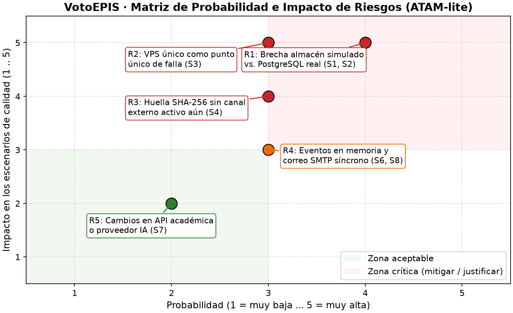

# Laboratorio 08 — E3 y E7: Informe de Evaluación ATAM-lite y Matriz de Riesgos

Fecha: 31/10/2026.  
Alcance: Evaluación arquitectónica frente al escenario de crecimiento (**25 000 votantes en 8 horas con auditoría externa**), consolidando los hallazgos propios, la revisión adversarial asistida por IA y la evaluación cruzada.

---

## 1. Hallazgos de la Evaluación ATAM-lite (Puntos de Sensibilidad, Trade-offs, Riesgos y No Riesgos)

| Tipo de hallazgo | Escenario / Atributo | Descripción del hallazgo | Evidencia / Respuesta del equipo | Estado |
|---|---|---|---|---|
| **Punto de sensibilidad 1** | **S1, S2** (Integridad y Conservación) | El rechazo del 100 % de duplicados y la ausencia de participaciones huérfanas dependen críticamente de que `INSERT participacion` (con `UNIQUE`) e `INSERT voto` ocurran dentro de la misma frontera transaccional ACID. | Demostrado en `fitness/simular_integridad.py` (0 % → 100 % de rechazo) y `fitness/simular_recuperacion.py` (100 → 0 huérfanas). | **Confirmado y protegido por `test_ff03`**. |
| **Punto de sensibilidad 2** | **S4** (Auditabilidad externa) | La validez del hash `SHA-256` ante un auditor externo es altamente sensible a la serialización canónica del listado (`sort_keys=True`, UTF-8 compacto) y a que la huella de referencia se custodie fuera de la base de datos[cite: 55, 62]. | Verificado en `fitness/simular_auditoria.py` y `test_ff04`/`test_ff05`: cualquier alteración de 1 voto o del total invalida el hash[cite: 55, 58]. | **Confirmado y protegido por `test_ff04` y `test_ff05`**. |
| **Punto de sensibilidad 3** | **S6** (Rendimiento p95 ≤ 2 s) | El tiempo de respuesta p95 de `emitir_voto` depende de la latencia del proveedor externo de padrón cuando se activa `ConReintentos(intentos=3)` ante `TimeoutError`[cite: 54]. | En pruebas HTTP reales con Locust (Reto A), sin timeouts externos el p95 es de 3 ms a 16,2 req/s; con timeouts repetidos el hilo retiene la petición. | **Confirmado (ajustar timeout corto por intento)**. |
| **Punto de trade-off 1** | **S1/S2** (Integridad/Fiabilidad) vs. **S6** (Rendimiento) | La restricción `UNIQUE(estudiante_id, eleccion_id)` y la transacción ACID aseguran 0 votos duplicados y 0 registros parciales, pero introducen bloqueos y serialización de conflictos en la base de datos bajo ráfagas concurrentes. | **ADR-006 y ADR-007**: Se prioriza la integridad electoral (QA-01) sobre la latencia marginal, dado que incluso a 16,2 req/s el p95 local fue de 3 ms. | **Trade-off aceptado**. |
| **Punto de trade-off 2** | **S4** (Auditabilidad) vs. **S5** (Confidencialidad) | Publicar el listado detallado de 25 000 votos permite al auditor externo recalcular el escrutinio (S4), pero incluir metadatos temporales o de orden de inserción podría facilitar ataques de correlación temporal contra el secreto del voto (S5)[cite: 54, 62]. | **ADR-008**: El listado exportado omite `estudiante_id` y marcas de tiempo, conteniendo únicamente `eleccion_id` y `candidato_id`[cite: 55, 62]. | **Trade-off mitigado en el formato de exportación**. |
| **Riesgo R1** | **S1, S2** (Integridad / Conservación) | El código en `src/votacion/` sigue operando con `AlmacenElectoralSimulado` en memoria, mientras que las pruebas SQL usan SQLite en `fitness/`; falta el adaptador productivo para PostgreSQL 16[cite: 54, 60, 61]. | Riesgo real: sin el repositorio PostgreSQL conectado a `ServicioVotacion`, las garantías demostradas en prototipo no están activas en producción. | **Zona Crítica (Mitigación definida)**. |
| **Riesgo R2** | **S3** (Continuidad ≥ 99,5 %) | Despliegue en un **único VPS económico (R-04)** constituye un punto único de falla (SPOF) durante las 8 horas de votación de los 25 000 estudiantes. | Riesgo real: una caída del host o contenedor detiene la jornada electoral al no existir clúster de alta disponibilidad[cite: 61]. | **Zona Crítica (Aceptado con plan de contingencia)**. |
| **Riesgo R3** | **S4** (Auditabilidad externa) | La copia externa de la huella `SHA-256` está simulada en las pruebas; aún no existe un canal externo inmutable implementado (portal institucional separado o envío firmado al comité)[cite: 55, 62]. | Riesgo real: si el hash se guarda solo en la misma BD, un administrador malicioso podría modificar los votos y recalcular el hash del acta[cite: 62]. | **Zona Crítica (Mitigación parcial en E4)**. |
| **Riesgo R4** | **S6, S8** (Rendimiento y Auditoría de rechazos) | El envío de correo en `ConfirmacionCorreo` es síncrono y `AuditoriaSeguridad` guarda eventos en una lista en memoria si no se enlaza a la tabla `evento` con permisos de solo inserción[cite: 54, 60]. | Un fallo del servidor SMTP degradaría la latencia de emisión y un reinicio perdería eventos en memoria[cite: 54, 60]. | **Zona Moderada (Mitigación planificada)**. |
| **Riesgo R5** | **S7** (Modificabilidad) | Cambios inesperados en el contrato del Sistema Académico UNSA o del proveedor LLM del asistente de reglamento. | Impacto acotado gracias a `SistemaAcademicoAdapter`, `FabricaFuentes` y `ProveedorLLM`[cite: 54]. | **Zona Aceptable**. |
| **Falso positivo 1 (Refutado)** | **S6** (Rendimiento) | *"El monolito en capas no soportará 25 000 votantes y requiere migrar a microservicios con una cola Kafka/RabbitMQ antes del lanzamiento"*. | **Refutado con evidencia:** 25 000 votos en 8 h equivalen a 0,87 req/s de media y 16,67 req/s en pico[cite: 54]. En la medición HTTP real con FastAPI y Locust (Reto A), el monolito procesó **16,21 req/s con p95 = 3 ms** (umbral ≤ 2000 ms) y 0 % de errores. | **Rechazado (Falso positivo)**. |
| **Falso positivo 2 (Refutado)** | **S4** (Auditabilidad) | *"Sin una red Blockchain / Hyperledger es imposible que un auditor externo detecte si se alteró un voto o el acta electoral"*. | **Refutado con evidencia:** `fitness/simular_auditoria.py` y `test_ff04`/`test_ff05` demuestran detección del **100 %** ante adulteración de votos o totales usando JSON canónico y `SHA-256` externo[cite: 55, 58, 62]. | **Rechazado (Falso positivo)**. |
| **No riesgo 1** | **S7** (Modificabilidad) | Incorporar una tercera fuente de padrón electoral sin modificar `ServicioVotacion` ni romper las capas del monolito[cite: 54]. | Respaldado por `test_open_closed_nueva_fuente_sin_modificar_servicio` y por los contratos `FF-01` y `FF-02` de `import-linter`[cite: 51, 59]. | **No riesgo verificado**. |
| **No riesgo 2** | **S5** (Confidencialidad de campos) | Ausencia de `estudiante_id` en los registros de voto y ausencia de `candidato_id` en los eventos publicados por `PublicadorEventos`[cite: 54]. | Verificado automáticamente por `test_voto_no_contiene_identidad_del_estudiante` y `test_ff04_s4_auditoria_integra_25000_votos`[cite: 58]. | **No riesgo verificado**. |

---

## 2. Matriz de Probabilidad e Impacto de Riesgos

| ID | Riesgo | Escenario afectado | Probabilidad (1–5) | Impacto (1–5) | Severidad (P × I) | Zona |
|---|---|---|---:|---:|---:|---|
| **R1** | Brecha entre almacén simulado/SQLite y adaptador PostgreSQL productivo | S1, S2 | 4 | 5 | **20** | **Crítica** |
| **R2** | Único VPS económico (R-04) como punto único de falla durante la jornada | S3 | 3 | 5 | **15** | **Crítica** |
| **R3** | Huella `SHA-256` del acta sin publicación activa en canal externo independiente | S4 | 3 | 4 | **12** | **Crítica** |
| **R4** | Eventos de seguridad en memoria y notificación SMTP síncrona en el hilo de voto | S6, S8 | 3 | 3 | **9** | **Moderada** |
| **R5** | Cambio de esquema en Sistema Académico UNSA o proveedor LLM | S7 | 2 | 2 | **4** | **Aceptable** |

---

## 3. Mitigación o Justificación de Aceptación para los Riesgos de la Zona Crítica

1. **R1 — Brecha entre almacén simulado/SQLite y PostgreSQL productivo (P=4, I=5 → Crítico):**
   * **Estrategia (Mitigación técnica prioritaria):** Implementar el adaptador concreto `AlmacenElectoralPostgreSQL` siguiendo exactamente el esquema y la frontera transaccional validados en `AlmacenPrototipo` (`fitness/simular_integridad.py` y `fitness/simular_recuperacion.py`)[cite: 56, 57], manteniendo intactas las *fitness functions* `FF-01`, `FF-02` y `FF-03` en GitHub Actions.
2. **R2 — VPS único como punto único de falla frente a S3 (P=3, I=5 → Crítico):**
   * **Estrategia (Riesgo aceptado para el MVP con contingencia operativa):** Debido a la restricción presupuestaria **R-04** (presupuesto bajo, un solo VPS) y al plazo **R-01** (1 mes)[cite: 54, 60], no es viable contratar un clúster multi-nodo con failover automático en esta etapa. Se acepta el riesgo para el MVP mitigándolo operativamente mediante: (a) política `restart: unless-stopped` en Docker Compose, (b) copias de seguridad automatizadas y WAL archiving de PostgreSQL, y (c) ventana de recuperación documentada en caso de reinicio del servidor.
3. **R3 — Huella `SHA-256` sin canal externo activo al cierre (P=3, I=4 → Crítico):**
   * **Estrategia (Mitigación parcial en Iteración 3 + acción de cierre):** La lógica de generación canónica y verificación criptográfica ya fue construida y protegida en CI mediante `fitness/simular_auditoria.py`, `test_ff04` y `test_ff05`[cite: 55, 58]. Para cerrar el riesgo antes de la elección real, al transicionar la elección al estado `PUBLICADA` se enviará automáticamente el hash `SHA-256` por correo institucional a las cuentas del Comité Electoral y del Auditor Externo, además de publicarlo en el repositorio institucional de actas[cite: 62].